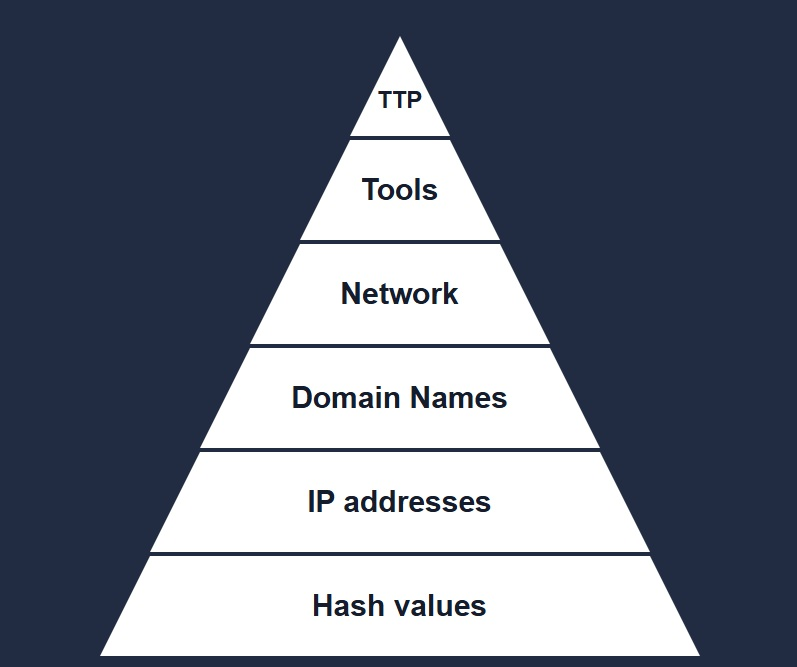
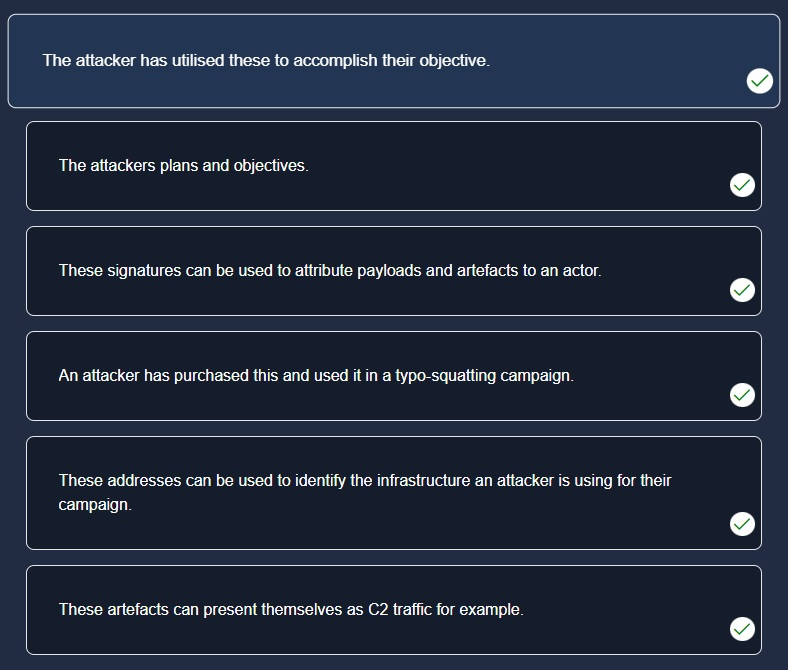

# Portefólio de Cibersegurança 

Bem-vindo ao meu portefólio.
Sou o Pedro Viães, de momento aluno de um CET Nível 5 - Especialista em Cibersegurança, com o objetivo de trabalhar como analista SOC / blue team. 

**Conteúdo**

- **Laboratório SOC com Wazuh e Sysmon:** em construção.
- **Estudos guiados (TryHackMe):** salas que resolvi para consolidar conceitos de deteção e resposta a incidentes (abaixo).
  
## Estudo guiado 1: Pyramid of Pain (TryHackMe)

### 1. Introdução e Objetivo

Sala do TryHackMe sobre a **Pyramid of Pain**, um modelo que classifica os indicadores de compromisso (IoCs) pela dificuldade que causa ao atacante quando são bloqueados. Usei-a para perceber porque é que as deteções baseadas em comportamento são mais robustas do que as baseadas em hashes ou IPs.

O exercício consistiu em associar seis descrições de artefactos de um atacante ao nível correto da pirâmide.

---

### 2. O Conceito Técnico
A pirâmide está dividida em 6 camadas. Quanto mais alto subimos na pirâmide, mais difícil e dispendioso é para o atacante alterar o seu comportamento, tornando a nossa deteção muito mais robusta:

* **Hash Values (Trivial):** Assinaturas únicas de ficheiros (MD5, SHA-256). Mudar um único bit no ficheiro altera o hash.
* **IP Addresses (Easy):** Endereços de rede. O atacante pode mudar de IP facilmente usando VPNs ou proxies.
* **Domain Names (Simple):** Nomes de domínio (ex: `malicious-site.com`). Exige registo, mas continua a ser simples de alterar.
* **Network/Host Artifacts (Annoying):** Rastros na rede (User-Agents) ou no sistema operativo (chaves de registo). Dá trabalho ao atacante modificar.
* **Tools (Challenging):** Software usado para o ataque (ex: Mimikatz, Nmap). Obriga o atacante a reconfigurar ou programar ferramentas novas.
* **TTPs (Tough):** Táticas, Técnicas e Procedimentos. O comportamento/metodologia do atacante. Mudar as TTPs obriga o adversário a reaprender o seu próprio *modus operandi*.

 

 

*Imagem: sala Pyramid of Pain, TryHackMe.*

**Nota:** no laboratório Wazuh + Sysmon vou trabalhar sobretudo nos níveis **Tools** e **TTPs**, por exemplo a deteção de acesso à memória do LSASS (T1003.001), que é comportamento e não um hash ou um IP.

---

### 3. Resolução 

Na sala, cada descrição do comportamento ou de um artefacto de um atacante tinha de ser associada ao nível correto da pirâmida. Em vez de decorar, usei a pergunta-guia do modelo: **quanto trabalho dá ao atacante mudar isto?**

Alguns exemplos do raciocíonio:

- Um domínio comprado para uma campanha de *typo-squatting* é barato e fácil de substituir, por isso pertence aos níveis mais baixos.
- Tráfego de comando e controlo (C2) com um padrão reconhecível é um artefacto de rede, que dá mais trabalho alterar do que um IP.
- Os planos e objetivos do atacante correspondem ao topo (TTPs), porque mudá-los obriga-o a mudar a forma de atuar.
  
 

 

*Imagem: exercício da sala Pyramid of Pain, TryHackMe.*

---

### 4. Conclusão

Esta sala reforça que uma defesa de SOC moderna não pode depender apenas de listas de IPs ou hashes conhecidos (a base da pirâmide), pois são fáceis de contornar. 

Para criar resiliência a longo prazo, as equipas de blue team devem apostar em detenções baseadas em **TTPs** e **ferramentas** a frameworks como MITRE ATT&CK. Assim, mesmo que o atacante mude de infraestrutura, o seu comportamento suspeito continua a ser detetável.

---

## Estudo guiado 2: Unified Kill Chain (TryHackMe)

### 1. Introdução e Objetivo

Sala do TryHack Me sobre a **Unified Kill Chain**, um modelo que descreve as fases de um ataque, desde o reconhecimento inicial até ao impacto final.
Usei-a para perceber como as ações de um atacante se encadeiam e em que fase uma de deteção ou uma contenção pode travá-lo.

O objetivo foi entender como mapear as ações de um atacante em cenários complexos de persistência e movimentação interna, aplicando os conceitos chave de Defesa Ativa.

---

### 2. O Conceito Técnico
Ao contrário dos modelos lineares antigos, a **Unified Kill Chain** adapta-se aos ambientes modernos dividindo um ataque em **18 fases** agrupadas em 3 grandes blocos operacionais:
- **In (Entrar / Initial Foothold):** reconhecimento, preparação do ataque, entrega, engenharia social, exploração, persistência, evasão de defesas e comando e controlo (C2).
- **Through (Navegar / Network Propagation):** pivotagem, descoberta, escalada de privilégios, execução, acesso a credenciais e movimentação lateral.
- **Out (Executar / Action on Objectives):** recolha de dados, exfiltração, impacto e cumprimento dos objetivos.

Esta abordagem adota a mentalidade de **"Assumir a Invasão" (Assume Breach)**, permitindo à equipa do SOC detetar o adversário mesmo que as defesas perimetrais falhem.

 

 

*Imagem: sala Unified Kill Chain, TryHackMe.*

---

### 3. Resolução

Na parte prática da sala, aparecia uma descrição de uma ação do atacante e eu tinha de escolher, entre várias opções, a fase da Unified Kill Chain a que correspondia.

**O que retirei:** claro que se torna dificil decorar as 18 fases, mas, distinguir as que parecem semelhantes também se torna um quebra-cabeças. Reconhecimento e descoberta, por exemplo, são ambas recolha de informação, mas a primeira acontece antes de o atacante entrar e a segunda já dentro da rede.

---

### 4. Conclusão 
Conhecer a fase em que o atacante se encontra, ajuda um analista de SOC a estruturar a resposta. Se acabar por perceber que o atacante está mesmo numa fase de movimentação lateral, por exemplo, faz sentido priorizar a contenção do segmento de rede afetado antes que o incidente chegue à exfiltração ou à destruição de dados.

Ferramentas de automação (SOAR) podem acelerar essa resposta, mas as decisões continuam a depender de análises humanas.

---

## Estudo guiado 3: MITRE (TryHackMe)

### 1. Introdução e Objetivo

Sala do TryHackMe sobre os recursos da MITRE para a comunidade de cibersegurança: o **ATT&CK**, o **CAR** (Cyber Analytics Repository) e o **D3FEND**. Usei-a para perceber como o comportamento dos atacantes é catalogado em táticas e técnicas, e como esse catálogo serve de base para pensar em deteções e em defesas.

---

### 2. O Conceito Técnico
* **MITRE ATT&CK:** Uma base de dados global que cataloga táticas (os objetivos do hacker) e técnicas (como ele executa esses objetivos) baseada em observações do mundo real.
* **MITRE CAR:** Um repositório complementar que fornece lógicas de deteção e *queries* prontas (Splunk, EQL) baseadas no modelo ATT&CK, servindo como a "ficha técnica" para criar alertas de segurança.
* **MITRE D3FEND:** Um catálogo de contramedidas defensivas, que funciona como o "lado defensivo" do ATT&CK.

---
### 3. Resolução

A sala combinava leitura com perguntas e pequenos exercícios. Os pontos em que trabalhei mais foram:

**Mapear um grupo no ATT&CK Navigator (Task 3).** O exemplo era o grupo **Mustang Panda (G0129)**, representado na matriz Enterprise do ATT&CK. As técnicas destacadas mostravam o comportamento do grupo: *phishing* para o acesso inicial, tarefas agendadas para a persistência, ficheiros ofuscados para a evasão de defesas e transferência de ferramentas para dentro da rede (*ingress tool transfer*) para o comando e controlo. Respondi também a perguntas sobre como ler uma página de técnica: a que tática pertence e qual é o seu ID.

**Cenário de threat intelligence (Task 4).** O cenário punha-me como analista de segurança numa empresa do setor da aviação que estava a migrar para a cloud. A tarefa era usar a secção *Groups* do ATT&CK e o Navigator para identificar grupos que visam este setor, perceber as suas táticas e técnicas e avaliar lacunas na cobertura defensiva.

**Análise de uma deteção do CAR (Task 5).** Estudei o CAR-2020-09-001 (*Scheduled Task - File Access*), que procura ficheiros criados nas pastas onde o Task Scheduler guarda as tarefas (`C:\Windows\Tasks` e `C:\Windows\System32\Tasks`) por processos que não sejam o `svchost.exe`. Está associado à técnica Scheduled Task/Job e às táticas de execução, persistência e escalada de privilégios, e traz exemplos em pseudocódigo e em Splunk com Sysmon.

**D3FEND e outros projetos (Tasks 6 e 7).** O D3FEND organiza as contramedidas defensivas em sete táticas. A sala apresenta ainda o Adversary Emulation Library, o Caldera (emulação automatizada de adversários) e, de passagem, o AADAPT e o ATLAS.

---

### 4. Conclusão

O ATT&CK dá à comunidade uma linguagem comum para descrever o comportamento dos atacantes, e o CAR e o D3FEND mostram o outro lado: como detetar e como defender.

A sala tem um exemplo que liga as peças: o Mustang Panda mantém persistência com tarefas agendadas, e o CAR-2020-09-001 é uma deteção pensada precisamente para esse comportamento. É assim que um analista de SOC passa de um relatório de ameaça a algo que se pode procurar nos logs.

---

## Projeto 4: Caso de Estudo Combinado - Deteção Avançada e Erradicação de Ameaças (Salas Summit & Eviction)

### 1. Introdução e Objetivo
Este projeto prático eleva os conceitos teóricos de frameworks para um cenário simulado de Resposta a Incidentes (IR) corporativos em tempo real. O objetivo foi atuar como Analista de SOC na contenção de um ataque interativo persistente conduzido por um ator de ameaças avançado (APT), aplicando engenharia de deteção para travar a infraestrutura do hacker e executar procedimentos de erradicação (*eviction*).

---

### 2. Metodologia de Deteção Comportamental (Fase Summit)
Durante a fase de contenção, o adversário tentou contornar as defesas perimetrais tradicionais através de técnicas de rotação dinâmica de endereços IP (*Fast-Flux*). 

A estratégia para neutralizar esta progressão baseou-se na transição de deteções estáticas para **deteções comportamentais baseadas no Sysmon**:
* **Identificação do Beaconing:** Em vez de isolar um IP externo fixo, foi mapeada a assinatura mecânica imutável do malware (padrão de tráfego de Comando e Controlo contínuo com pacotes estritos de 97 bytes a cada 30 minutos / 1800 segundos).
* **Uso da Variável Universal `%temp%`:** Para travar a persistência no Host sem depender de caminhos absolutos de utilizador, foi criada uma regra de monitorização na "bancada de trabalho" temporária do Windows, intercetando a criação e o despejo (*data staging*) de ficheiros de exfiltração ocultos (`exfiltr8.log`).

---

### 3. Procedimento de Erradicação e Pós-Incidente (Fase Eviction)
Após a mitigação dos canais de C2, a investigação focou-se na destruição dos mecanismos de persistência internos remanescentes na rede corporativa, recorrendo ao mapeamento da matriz **MITRE ATT&CK**:
* **Execução e Acesso Inicial:** Análise de vetores de engenharia social focados em *User Execution* através do cruzamento de *Malicious Links* e *Malicious Files*, identificando o abuso de interpretadores legítimos como o **PowerShell** e o **Windows Command Shell**.
* **Proteção de Repositórios Críticos:** Identificação do repositório organizacional **SharePoint** como o alvo principal do APT para roubo de propriedade intelectual (*Data from Information Repositories - T1277*).
* **Bloqueio de Exfiltração Oculta:** Mapeamento de tentativas de fuga de dados através de técnicas de evasão de rede, especificamente a implementação de regras rígidas contra estruturas de *External Proxies* e *Multi-hop Proxies* para cegar a comunicação reversa do atacante.

---

### 4. Conclusão Técnico-Operacional
A resolução combinada deste cenário demonstra a importância da mentalidade *Assume Breach*. Um Analista de SOC eficaz não procura apenas bloquear indicadores triviais (como IPs e Hashes), mas sim compreender o *modus operandi* (TTPs) do adversário. A erradicação total só foi alcançada ao correlacionar as alterações internas no Host (Logs do Sysmon e modificações no Registo) com o comportamento anómalo do tráfego de saída (Egress), garantindo o despejo completo da ameaça sem interrupção dos serviços legítimos.
